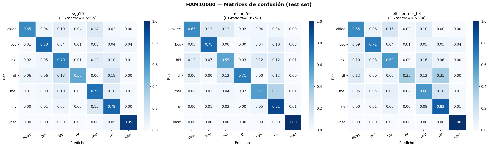
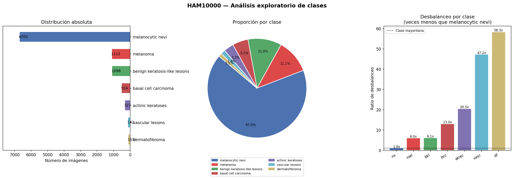
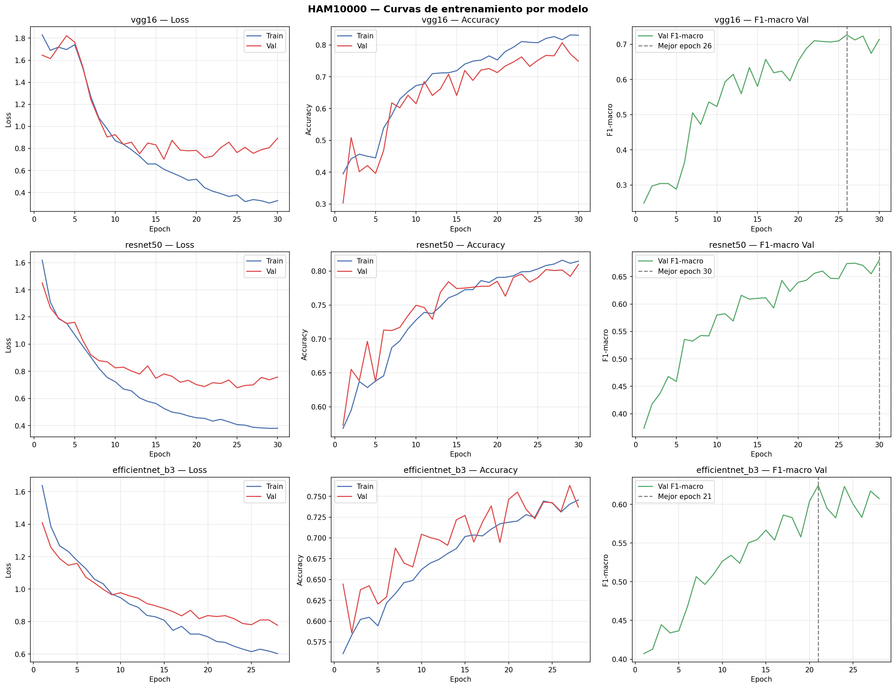
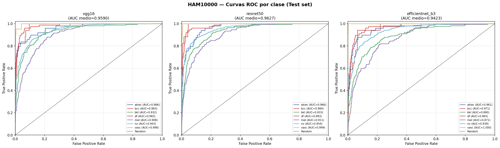

# Skin lesion classification on HAM10000 with CNN transfer learning

Seven-class classification of dermoscopic images (HAM10000) comparing three ImageNet-pretrained CNNs in PyTorch — **VGG16, ResNet50 and EfficientNet-B3** — under severe class imbalance.

This repository contains the code and results of my MSc thesis in Bioinformatics (Universidad Europea, 2026): *Diseño e implementación de una red neuronal convolucional para la clasificación de imágenes dermatológicas* ("Design and implementation of a convolutional neural network for the classification of dermatological images"). Code comments are in Spanish; this README documents the full pipeline in English.

## Key results (held-out test set, n = 1,502)

| Model | Accuracy | Macro-F1 | Weighted-F1 | Macro-precision | Macro-recall | Mean AUC |
|---|---|---|---|---|---|---|
| **VGG16** (selected) | 0.772 | **0.700** | 0.789 | **0.693** | 0.737 | 0.959 |
| ResNet50 | **0.817** | 0.676 | **0.817** | 0.641 | **0.738** | **0.963** |
| EfficientNet-B3 | 0.760 | 0.618 | 0.773 | 0.581 | 0.678 | 0.942 |

The final model was chosen **on the validation set only** (best validation macro-F1: VGG16 0.726, ResNet50 0.680, EfficientNet-B3 0.624) and the test set was used once, for the evaluation above.

Macro-F1 was the selection criterion because accuracy is dominated by the majority class (melanocytic nevi, 67% of images). The difference matters clinically: ResNet50 has the highest accuracy, but it misclassifies 31% of melanomas as nevi (melanoma recall 0.57), whereas VGG16 reaches a melanoma recall of 0.75.



## Dataset

[HAM10000](https://doi.org/10.1038/sdata.2018.161) (Tschandl, Rosendahl & Kittler, *Scientific Data*, 2018): 10,015 dermoscopic images in seven diagnostic classes.

| Code | Class | Images |
|---|---|---|
| nv | Melanocytic nevi | 6,705 |
| mel | Melanoma | 1,112 |
| bkl | Benign keratosis-like lesions | 1,098 |
| bcc | Basal cell carcinoma | 514 |
| akiec | Actinic keratoses | 327 |
| vasc | Vascular lesions | 142 |
| df | Dermatofibroma | 115 |

The imbalance between the largest and smallest class is 58×.

**The images are not included in this repository.** Obtain HAM10000 from its original source and respect its licence terms. The scripts read the dataset in Supervisely project format: one annotation file per image (`ds/ann/<image>.jpg.json`, class in `objects[0].classTitle`), the images in `ds/img/`, and an optional `meta.json`.



## Method

| Step | Details |
|---|---|
| Split | Stratified 70 / 15 / 15 (train 7,009 · val 1,502 · test 1,502), seed 42. The exact splits are in `results/splits/`. |
| Imbalance | Class-weighted cross-entropy with balanced weights (`results/class_weights.json`). |
| Augmentation | Resize to 256 and random 224 crop, horizontal and vertical flips, rotation ±20°, colour jitter. ImageNet normalisation. |
| Backbones | VGG16, ResNet50 and EfficientNet-B3 with ImageNet weights; the classification head is replaced by a 7-class layer. |
| Training | Two phases. **Warm-up:** 5 epochs training only the new head, with Adam at lr 1e-3. **Fine-tuning:** the whole network, with differential learning rates (backbone 1e-5, head 5e-5). |
| Schedule | ReduceLROnPlateau on validation macro-F1; early stopping with patience 7; maximum 30 epochs; batch size 32. |
| Model selection | Best validation macro-F1 checkpoint per architecture; best architecture chosen on validation. |
| Evaluation | One pass on the test set: accuracy, macro- and weighted-F1, per-class precision and recall, confusion matrices, one-vs-rest ROC curves. |





## Repository structure

```
├── fase1_exploracion.py        # Phase 1: parse annotations, build master CSV, class distribution
├── fase2_preprocesamiento.py   # Phase 2: stratified splits and class weights
├── fase3_entrenamiento.py      # Phase 3: training of the three architectures
├── fase4_evaluacion.py         # Phase 4: test-set evaluation and figures
├── requirements.txt
└── results/
    ├── test_metrics.csv        # summary metrics on the test set
    ├── class_weights.json
    ├── splits/                 # exact train / val / test image lists used in the thesis
    └── figures/                # all figures produced by the pipeline
```

## How to run

```bash
# 1. Environment (install PyTorch with the CUDA build for your GPU first)
pip install -r requirements.txt

# 2. Place the dataset in the project root:
#    ds/ann/*.jpg.json   ds/img/*.jpg   meta.json (optional)

# 3. Run the four phases from the project root
python fase1_exploracion.py
python fase2_preprocesamiento.py
python fase3_entrenamiento.py      # ~1.5–2 h on an RTX 3050 (4 GB)
python fase4_evaluacion.py
```

Generated files go to `outputs/`, and model weights go to `outputs/modelos/`; both are git-ignored. Phase 2 reproduces exactly the splits in `results/splits/`.

## Limitations

- **Image-level split.** HAM10000 includes several images of the same lesion for part of the cases. The annotation format used here does not carry lesion identifiers, so the split is stratified by class at image level. Images of the same lesion may therefore fall into different splits, and the test metrics are likely optimistic. A lesion-grouped split (using `lesion_id` from the original HAM10000 metadata) is the first change I would make.
- **Single split and seed.** There are no confidence intervals or repeated cross-validation.
- **Fixed 224 × 224 input for all backbones.** Images (600 × 450) are resized without preserving the aspect ratio, and EfficientNet-B3 is trained below its native resolution (300 px). This may partly explain its weaker results.
- **No external validation** on an independent dermoscopy dataset.

## Future work

Lesion-grouped splitting, resolution matched to each backbone, saliency maps (e.g. Grad-CAM) to check what the models attend to, and an inference tool for new images.

## Citation of the dataset

Tschandl P, Rosendahl C, Kittler H. The HAM10000 dataset, a large collection of multi-source dermatoscopic images of common pigmented skin lesions. *Sci Data* 5, 180161 (2018). https://doi.org/10.1038/sdata.2018.161

## Author and licence

José Carlos León Miguel — [github.com/jcleonmiguel](https://github.com/jcleonmiguel)

The code is released under the MIT License (see `LICENSE`). The dataset is subject to its own licence.
